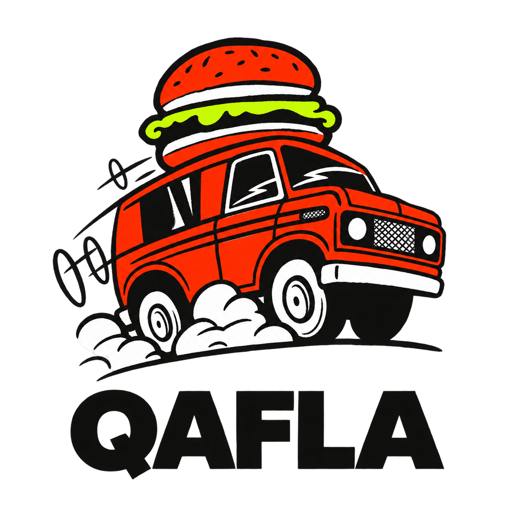

# Qafla Pickup · قافلة

## Overview

Picture a Dune Burgers poster pasted on the side of the truck. **DUNE** and **BURGERS** fill two lines in Snowy White. The field is Red Orange with a faint square grid. A cutout of a smash burger in its wrapper breaks the outer edge of the panel. One Yellow Punk marker stroke turns toward a small, level pickup-time sticker. At arm's length you can read the name and see when to come back.

Use that composition on Explore and at the head of a truck menu. Carry the same identity into checkout through a bold pickup time, a ticket edge and one accent. On the vendor board and manager grid, give the space to orders, counts and controls. The shared type, color and corner shapes connect all three roles.

Photograph food at counter height in appetizing, natural light. Keep one recognizable silhouette. Angle the image or its backing card by up to 6°. Keep labels, prices and buttons level. When a photo is missing, a bold truck name or a simple menu row completes the layout.

| At the park | What should catch the eye first | What follows |
| --- | --- | --- |
| A customer chooses dinner on a phone | The truck and its next pickup time | The dishes, prices, and cart |
| A vendor looks up during a rush | The order due next and what to cook | Its quantities, payment state, and next action |
| Dana checks the park | Which truck and time are busiest | The exact count, capacity, and orders behind it |

## Logo



The park logo pairs a right-facing Red Orange truck with a rooftop burger and Yellow Punk lettuce. The QAFLA wordmark sits below the wheels. Use the complete [transparent PNG](public/brand/qafla-logo.png) as one image. The app serves it at `/brand/qafla-logo.png`.

| Placement | How to use the logo |
| --- | --- |
| Launch screen | Fill the whole viewport, including a phone's safe areas, with Red Orange from the first rendered frame. Center the complete logo on a compact Snowy White tile with poster corners and 12 px of padding: the truck is Red Orange too and would disappear without it. Use a 168 px logo on phones and 208 px from 640 px up. Nothing else is on the screen. |
| Sign-in | Center the logo on Snowy White at 160 px on phones and 208 px from 640 px up. The Arabic park name, قافلة, can sit underneath as live text. The logo is simply present here; its entrance belongs to the launch screen. |
| Explore | Place the logo in the park masthead when at least 96 px of width is available. Keep the featured poster for the individual truck and its pickup time. |
| Checkout, vendor and manager screens | Use the localized park name as text in compact headers. Give pickup times, order states and counts the visual priority. |

Keep the PNG square and scale both dimensions together. Its transparent margins provide the clear space. Keep adjacent controls, text and borders outside that square. On a dark, orange or photographic surface, give the complete logo a solid Snowy White backing so its ink strokes and wordmark stay legible. Preserve the original lettering, colors and right-facing orientation in both English and Arabic.

When the logo is the only content of a home link, give the link a localized accessible name such as “Qafla Pickup home” or “الصفحة الرئيسية لقافلة”. If adjacent text or a heading already names the app, use an empty image alt attribute so the name is announced once.

## Colors

The three brand swatches are **Red Orange** `#F42902`, **Snowy White** `#FDFDFF` and **Yellow Punk** (working screen match `#C6F900`). Use orange in broad areas where a truck introduces itself, white behind menus and forms, and lime for one point of attention within a composition. Near-black ink makes the small type readable.

```yaml
colors:
  red-orange: "#F42902"
  snowy-white: "#FDFDFF"
  yellow-punk: "#C6F900"
  primary: "#101010"
  primary-pressed: "#2C2C2C"
  on-primary: "#FDFDFF"
  surface: "#FDFDFF"
  subtle: "#F1F0F3"
  ink: "#101010"
  muted: "#555258"
  divider: "#D9D7DD"
  outline: "#767277"
  focus: "#101010"
  ready: "#101010"
  ready-surface: "#C6F900"
  warning: "#6F4100"
  warning-surface: "#FFF0CE"
  error: "#8B1830"
  error-surface: "#FFE8EC"
```

| Pair | Intended use | Measured contrast |
| --- | --- | --- |
| Snowy White on Red Orange | Solid background behind oversized poster lettering (32 px or larger) | 4.00:1 |
| Ink on Red Orange | Small masthead text and language control | 4.68:1 |
| Ink on Snowy White, or reversed | Prices, ticket details and primary button | 18.73:1 |
| Ink on Yellow Punk | Pickup-time sticker and ready notice | 15.36:1 |
| Muted on Snowy White | Cuisine and helper text | 7.56:1 |
| Warning on warning surface | Capacity warning or refund due | 7.65:1 |
| Error on error surface | Form error or rejected order | 7.93:1 |

Use `divider` for separators and `outline` for field boundaries. Use a 3 px ink focus ring with a 2 px white gap. Give lime stickers an ink edge on light surfaces. Keep lime strokes decorative wherever they sit directly on orange. Every state has a visible label. Put type over a flat fill where an image or grid would interrupt its strokes.

## Typography

**Archivo Black** is Qafla's English display face. Its wide, heavy capitals give short truck names the weight of the reference poster. Set long names on two or three deliberate lines. **DM Sans** carries menu items, prices, instructions and controls. **Alexandria** gives Arabic titles comparable weight at 900 and handles Arabic body copy at 400. These are implementation picks for the reference's feel.

```yaml
typography:
  display: {fontFamily: Archivo Black, fontSize: "clamp(44px, 8vw, 104px)", fontWeight: 400, lineHeight: 0.94, letterSpacing: "-0.035em"}
  heading: {fontFamily: DM Sans, fontSize: 32px, fontWeight: 800, lineHeight: 1.12}
  item: {fontFamily: DM Sans, fontSize: 18px, fontWeight: 600, lineHeight: 1.4}
  body: {fontFamily: DM Sans, fontSize: 16px, fontWeight: 400, lineHeight: 1.5}
  label: {fontFamily: DM Sans, fontSize: 14px, fontWeight: 600, lineHeight: 1.45}
  ar:
    display: {fontFamily: Alexandria, fontSize: "clamp(38px, 6vw, 80px)", fontWeight: 900, lineHeight: 1.35}
    heading: {fontFamily: Alexandria, fontSize: 28px, fontWeight: 600, lineHeight: 1.45}
    item: {fontFamily: Alexandria, fontSize: 18px, fontWeight: 600, lineHeight: 1.6}
    body: {fontFamily: Alexandria, fontSize: 16px, fontWeight: 400, lineHeight: 1.7}
    label: {fontFamily: Alexandria, fontSize: 14px, fontWeight: 600, lineHeight: 1.6}
```

Uppercase short English poster titles with CSS so the canonical truck name keeps its spelling. Use sentence case on buttons, menus and dashboards. Archivo Black's regular cut supplies its weight. Use DM Sans Bold for ticket times and align prices and capacity counts with tabular numerals. Give amounts room for three decimals. Keep Arabic tracking at zero and allow breathing room above dots and below descenders. Use system sans-serif fallbacks while fonts load.

## Layout

```yaml
spacing:
  xs: 4px
  sm: 8px
  md: 12px
  gutter: 16px
  lg: 24px
  xl: 32px
  section: 48px
```

| Width | Customer | Operations |
| --- | --- | --- |
| Under 768 px | One column, 16 px side gutters. The cart action sits above the safe area. Leave enough bottom space for the last item and the focused control. | A vendor gets a due-time list. Dana gets a time selector followed by six truck rows with exact counts. |
| 768–1023 px | 24 px gutters. Explore can use two columns. Keep checkout in one readable column. | Group tickets by pickup time. The manager's time grid can scroll inside its own labeled region. |
| 1024 px and up | Center content within 1160 px. Place the menu beside a 320 px cart summary. Keep forms within 640 px. | Expand to 1440 px. Keep truck names and time headings visible when the manager scrolls the grid. |

On Explore, put the park name, today's hours and language control at the top. Use the first truck as a compact poster and show its pickup sticker within the same link. At 390 px wide, aim to show the start of the next truck in the first viewport. On a menu, place the food image in the open corner of the title panel. Put the first dish immediately below. Keep one-handed actions near the bottom.

## Elevation & Depth

On a featured poster, draw a 1 px square grid on a 24 px rhythm in white at 7% opacity and keep the grid clear of small text. A pickup sticker can have a 1 px ink edge and a crisp 3 px offset shadow. Use a 16 px corner radius on the poster. Use flat white rows and thin rules for dishes. Pin the cart bar on an opaque surface with a top rule. When a confirmation dialog closes, return focus to the invoking control.

## Shapes

```yaml
rounded:
  control: 8px
  panel: 12px
  indicator: 9999px
```

Use pill shapes for the language switch and pickup sticker, modest corners for controls, and a single dashed divider for the collection ticket. Let the ticket grow vertically in Arabic. The poster can carry one loose marker arrow or underline. Treat it as decoration and hide it from assistive technology. Mirror a directional flourish in RTL when it points toward the pickup sticker. Interface icons use a consistent 2 px stroke on a 24 px canvas.

## Motion & Micro-interaction

```yaml
motion:
  feedback: {duration: 120ms, timingFunction: ease-out}
  reveal: {duration: 180ms, timingFunction: ease-out}
```

**Launch.** The app has one authored moment. On the launch screen the truck rolls forward about 14 px and settles (520 ms, `cubic-bezier(0.2, 0, 0, 1)`), once per page load; the wordmark stays still, and the truck always travels left to right because it faces right in both languages. The screen leaves the instant the destination is known: no timer holds it up, and moving between screens inside the app never shows it again with motion. If the wait passes 0.7 s, three small Snowy White dots appear beneath the logo. With reduced motion the logo is static and the dots do not pulse; the status is announced to assistive technology either way.

Buttons respond immediately on press. Keep the button width stable while an order is being placed and announce progress. A new vendor ticket appears within its time group without stealing keyboard focus. When an order becomes ready, reveal a persistent Yellow Punk header with a check, the ready message and the truck name. Announce the change once to assistive technology. Reopening the order shows its current state. Keep poster artwork static and respect reduced motion by making transitions immediate.

## Voice & Content Strategy

Write like someone handing an order across a counter. Use short, specific English and natural Arabic for Kuwait. Put the decision in the button. Errors tell the customer what happened and what they can do next.

| Moment | English | العربية |
| --- | --- | --- |
| Select a slot | Choose pickup time | اختر وقت الاستلام |
| Submit a pay-at-pickup order | Place order | تأكيد الطلب |
| Choose a later time | Use 7:30 PM | اختر 7:30 م |
| A slot fills | The 7:15 PM slot just filled. Your cart is saved. | اكتمل الحجز لوقت 7:15 م. سلتك محفوظة. |
| Ready at the counter | Your order is ready for pickup | طلبك جاهز للاستلام |
| No slots left today | No pickup times left today | ما في أوقات استلام متاحة اليوم |
| A paid order is rejected | Refund due | المبلغ مستحق للاسترداد |
| AI suggestion fails | Couldn’t suggest a description. Try again or write your own. | تعذّر اقتراح وصف. حاول مرة ثانية أو اكتب الوصف بنفسك. |

Set the document language and direction per locale. Mirror back arrows, the stepper's reading order, and inline spacing. Keep food photographs and nondirectional symbols in their original orientation. Use logical CSS properties. Preserve the current route, cart, and selected slot when changing language. Keep the language switch visible as **العربية** or **English**.

Use Western digits in both locales for this design. Show `3.200 KWD` in English and `3.200 د.ك.` in Arabic. Isolate mixed-direction values and order references with `bdi` or equivalent markup. Display Kuwait time in both locales, e.g. `7:15 PM` and `7:15 م`. Apply translations as display labels while preserving canonical seed names, IDs, and prices.

## Components

```yaml
components:
  button-primary: {backgroundColor: "{colors.primary}", textColor: "{colors.on-primary}", rounded: "{rounded.control}", minHeight: 48px}
  button-primary-pressed: {backgroundColor: "{colors.primary-pressed}", textColor: "{colors.on-primary}"}
  slot-selected: {backgroundColor: "{colors.ink}", textColor: "{colors.surface}", rounded: "{rounded.control}"}
  pickup-ticket: {backgroundColor: "{colors.surface}", textColor: "{colors.ink}", rounded: "{rounded.panel}", padding: "{spacing.lg}"}
  pickup-sticker: {backgroundColor: "{colors.yellow-punk}", textColor: "{colors.ink}", borderColor: "{colors.ink}", rounded: "{rounded.indicator}"}
  ready-notice: {backgroundColor: "{colors.ready-surface}", textColor: "{colors.ready}", rounded: "{rounded.control}"}
```

### Customer

| Component | Composition and behavior |
| --- | --- |
| Truck listing | Show the canonical truck name or its localized label, cuisine, and earliest bookable time. Place closed trucks in a clearly labeled group if displayed. Show a text state when an open truck has no remaining slots. |
| Menu row | Item name first, three-decimal price aligned to the trailing edge, optional photo and description. The add control becomes a labeled quantity stepper. Support 1–10 of each item, with removal at one. Keep sold-out dishes readable and label them “Sold out”. |
| Slot picker | Use a labeled radio group. Available slots have a distinct outline. Selected slots use an ink fill, light text, and a check. Full slots show “Full” and cannot be selected. Times are 15 minutes apart and use today's Kuwait booking window. If a slot fills at confirmation, retain the items and payment choice and offer the next available time. |
| Cart and payment | Keep one truck per cart. If a customer switches trucks with items in their cart, explain and confirm the replacement. Show items, quantities, total, then the pay online or pay at pickup choice. Label the final action by its effect. Show “Confirming payment” while awaiting server confirmation. |
| Pickup ticket | At review, show the proposed time. After placement, lead with the confirmed time and truck, then order reference, status, and items. A persistent ready notice names the truck. Payment status has its own line. A placed order can be cancelled. A collected order unlocks a single 1–5 star rating and optional comment. |

### Vendor and park manager

| Component | Composition and behavior |
| --- | --- |
| Vendor ticket | Lead with pickup time, order reference, and quantities. Give the next valid action the primary button. From placed, the vendor can accept or reject with a reason. From accepted, advance to preparing, then ready, then collected. Use separate labels for kitchen status and payment. |
| Menu editor | Label price, availability, and description as distinct fields. Keep the photo, editable suggested description, and possible allergens together. Let the vendor review before saving. If the suggestion fails, keep the form usable and preserve their edits. |
| Manager's busy slots | Desktop grid has six truck rows and 24 quarter-hour columns. Tint non-full cells from white toward pale orange by utilization. A full cell uses ink on solid Red Orange and reads “6/6 · Full” for Dune Burgers. Print the exact count in every cell. Opening a cell shows the truck, time and qualifying orders. Count every order except rejected and cancelled. Give a closed truck its own explicit label. |
| Closing a truck | Dana sees the truck name, “Close for tonight”, and a confirmation explaining that new orders stop. Keep existing orders visible in the operational views. |

### Shared controls and states

Use a 48 px minimum primary-button height and at least a 44 × 44 px hit area for steppers, icon controls, and mobile slot options. Let height expand for translated text. Inputs have persistent labels, a focus ring, and inline errors linked to the field. During loading, reserve space for the content that will arrive. An empty order board says “No orders yet” and keeps the truck controls available. If the live connection drops, retain the last known order and show “Reconnecting” until the current state has been fetched.

## First Stitch review

Design three connected mobile screens in English. For **Explore**, use the Red Orange Dune Burgers poster, two-line Snowy White title, burger cutout and Yellow Punk pickup sticker. For **Menu**, repeat the typography on a more compact header, then show the five seeded dishes on white with aligned prices. For **Checkout**, show one level white ticket with the truck, time and total, a slot picker and an ink action button. Carry the eye from the pickup sticker on Explore to the confirmed time on the order ticket.

Use **Dune Burgers**. One **Classic smash** at **1.950 KWD** plus one **Loaded fries** at **1.250 KWD** totals **3.200 KWD**. In this example, the earliest pickup sticker reads **7:15 PM**. Checkout shows **7:00 PM full**, **7:15 PM selected** and **7:30 PM available**. Produce an Arabic RTL checkout and a second state in each language where 7:15 fills and the cart is kept. The new time should be easy to choose with one thumb.

Keep the Explore screen free of invented ratings, discounts, countdowns, and hero slogans. Let truck names, food, and availability do the work. Keep charts, decorative photography, and promotional copy off the kitchen board. If the proposed **Pick up together** feature is approved, reuse the slot picker and label matches “Available at both trucks”. The selection is a suggestion until each order is confirmed.

### Review a design against five questions

1. At 390 px wide, can someone name the truck, time, and total within five seconds of seeing checkout?
2. After switching to Arabic mid-order, are the quantities, time, and total intact and readable? At 320 px wide and with enlarged text, can the customer still reach the next action?
3. Can a keyboard user choose a slot, place an order, and hear a single ready update? In grayscale, can they distinguish a selected slot from a full one?
4. On a busy vendor board, can someone find the next due ticket and its permitted action without looking at payment details?
5. Can Dana distinguish **5/6** from **6/6** on both phone and desktop, then open the orders that explain the count?
