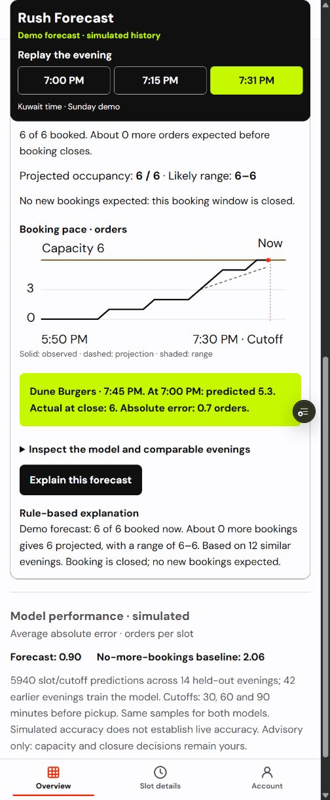

# Rush Forecast — deployed Preview verification

Verified on 22 November 2026 at 4:15 PM Kuwait time, using PR #17's current application head at the start of the check: `92398add9c77a023282389e14c6efda7b61071f7`.

- [Protected Preview](https://qafla-rjqd-17kdeehn1-ffalrefae-6713s-projects.vercel.app/manager?view=forecast), deployment `dpl_HLVp7ssd9nxDiJmUynCigDjqenfA`, READY.
- ChatGPT in-app browser (Chromium), **519 × 1253 CSS px**, English, existing Vercel-authenticated browser session and actual manager sign-in. No viewport override or physical-device claim. This deployed check is separate from the earlier local English/Arabic 320/390/1440 px checks.
- Opened Park overview → Forecast and selected an **At risk** slot. Used the deployed generator/model and explanation endpoint without intercepted responses. The dataset remains simulated; this does not establish live forecasting accuracy.
- No orders, payments, truck closures or capacity changes. Preview protection remained enabled. Opening the URL requires authorized Vercel access and a manager account; screenshots and [observed UI text](observations.json) require repository access only.

## Selected slot and original prediction

[Original selection screenshot](01-original.jpg)

| Field | Observed value |
| --- | --- |
| Truck | T02 — Dune Burgers |
| Pickup | 7:45 PM Kuwait time |
| Replay time | 7:00 PM |
| State | At risk |
| Current bookings | 3 |
| Capacity | 6 |
| Expected additional bookings | 2.3 |
| Projected bookings | 5.3 of 6 |
| Likely range | 4–6 orders |
| Places likely remaining | 0.7 |
| Booking cutoff | 7:30 PM, 30 minutes away |
| Comparable history | 12 similar simulated evenings |

## Explanation: OpenRouter answered

Selected **Explain this forecast**. The source label changed to **OpenRouter explanation**; the provider request did not fall back. [Explanation screenshot](02-explanation.jpg).

> Based on 12 simulated past evenings, the strongest signal is that the projected count of 5.3 against a capacity of 6 (range 4 to 6) puts the booking at risk of nearly filling, with about 30 minutes until close.

The answer matches the selected slot's projected count, capacity, range, history size and time until cutoff. It does not repeat the current count of 3 or additional estimate of 2.3; those remain visible in the slot details. No conflicting figures appeared.

## Advance past cutoff and rewind

Advanced to **7:31 PM**, beyond the 7:30 PM cutoff. The selected slot became **Booking closed**, with a final simulated count of **6 of 6**. The highlighted comparison retained the earlier prediction:

> Dune Burgers · 7:45 PM. At 7:00 PM: predicted 5.3. Actual at close: 6. Absolute error: 0.7 orders.

At the new replay time, the explanation correctly reverted to the rule-based closed-window explanation instead of retaining the earlier OpenRouter answer. This was a change of selection time, not a failed provider request.

Rewound to **7:00 PM**. Current bookings **3**, expected additional **2.3**, projection **5.3 of 6**, range **4–6**, and the 7:30 PM cutoff were restored. The forecast detail text before the explanation section was exactly identical to the original. The earlier OpenRouter answer reappeared for its matching slot/time. [Rewind screenshot](04-rewind.jpg).

**Demo forecast · simulated history** and the selected replay time stayed visible in the sticky header during selection, explanation, advance and rewind. All four captures show that label; its viewport visibility was also checked after rewinding.

## Scope

This verifies the deployed manager journey, provider source shown by the app, numerical consistency, outcome comparison and deterministic rewind in English at the viewport above. It adds no new Arabic, physical-device, live-order or statistical-accuracy claim. The follow-up commit only packages these observations and images; the application build tested is the SHA above. PR #17 remains open for visual approval.
